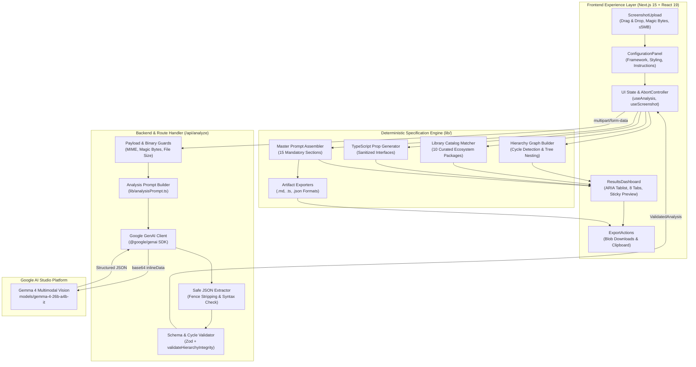

<div align="center">

# 📸 Screenshot2Spec

### AI-Powered Frontend Blueprint & Implementation Prompt Generator

_From screenshot to implementation-ready AI coding prompt — in seconds._

Tagline: **See It. Specify It. Build It.**  
Gemma 4 Multimodal Vision · Zod Contract Validation · Cycle-Free Component Hierarchy  
Intelligent Library Recommendations · TypeScript Props Outline · 15-Section AI Coding Prompt

[](frontend/)
[](backend/)
[-4285F4.svg?logo=googlegemini&logoColor=white)](https://ai.google.dev/gemma)
[](https://googleapis.github.io/js-genai/)
[](https://zod.dev/)
[](https://tailwindcss.com/)
[](#testing--verification)
[](#overview)
[](LICENSE)

</div>

---

## Table of Contents

- [Overview](#overview)
  - [The Problem](#the-problem)
  - [The Solution](#the-solution)
  - [Key Highlights](#key-highlights)
- [Core Workflow](#core-workflow)
- [System Architecture](#system-architecture)
- [Technology Stack](#technology-stack)
- [Project Structure](#project-structure)
- [Features & Results Dashboard](#features--results-dashboard)
  - [Screenshot Ingestion & Guardrails](#1-screenshot-ingestion--guardrails)
  - [Gemma 4 Multimodal Vision Analysis](#2-gemma-4-multimodal-vision-analysis)
  - [Component Hierarchy Reconstruction](#3-component-hierarchy-reconstruction)
  - [Intelligent Library Recommendations](#4-intelligent-library-recommendations)
  - [TypeScript Interface Generation](#5-typescript-interface-generation)
  - [15-Section AI Implementation Prompt](#6-15-section-ai-implementation-prompt)
  - [Developer Artifact Exporters](#7-developer-artifact-exporters)
- [Approved Library Catalog](#approved-library-catalog)
- [API Specification](#api-specification)
  - [POST `/api/analyze`](#post-apianalyze)
  - [Success Response Payload](#success-response-payload)
  - [Error Mapping & Safety](#error-mapping--safety)
- [Local Setup & Installation](#local-setup--installation)
  - [Prerequisites](#prerequisites)
  - [Unified / Fullstack Run](#unified--fullstack-run)
  - [Frontend Service](#frontend-service)
  - [Backend Service](#backend-service)
- [Environment Variables](#environment-variables)
- [Testing & Verification](#testing--verification)
- [Available Scripts](#available-scripts)
- [Deployment](#deployment)
- [Documentation Hub](#documentation-hub)
- [Team & Contributors](#team--contributors)

---

## Overview

**Screenshot2Spec** is an AI-powered developer productivity platform built for the **Best Use of Gemma 4** hackathon category. It transforms visual screenshots of websites and applications into production-grade, implementation-ready frontend development blueprints and comprehensive AI coding prompts.

Instead of attempting unverified, brittle end-to-end code synthesis, Screenshot2Spec acts as an **expert frontend architect**: it inspects UI layouts with Google's Gemma 4 vision model, validates structural integrity with Zod, matches components to a curated ecosystem catalog (Tailwind CSS, shadcn/ui, Recharts, Lucide React), generates type-safe contracts, and produces a battle-tested master prompt ready for Google Antigravity, Claude Code, Cursor, or GitHub Copilot.

### The Problem

Frontend developers and AI coding agents frequently receive visual UI references without accompanying technical specifications. A screenshot shows *what* an interface looks like, but fails to explain:
- **Component Architecture:** Which components to build, how they nest, and where boundaries lie.
- **Library Selection:** Which specialized packages should power charts, tables, navigation, or dialogs.
- **Dependencies:** Exact npm / npx commands needed without package hallucination.
- **Contracts:** Component props, TypeScript interfaces, and realistic data structures.
- **Responsiveness & State:** Breakpoint behaviors, accessibility needs, and user interaction states.
- **AI Prompting:** Vague prompts like *"recreate this image"* produce messy spaghetti code with missing dependencies and arbitrary CSS.

### The Solution

Screenshot2Spec bridges this gap through a 2-stage visual-to-specification engine:
1. **Multimodal Visual Understanding:** Gemma 4 (`models/gemma-4-26b-a4b-it`) analyzes the screenshot and decomposes it into layout regions, atomic components, design characteristics, and user interactions.
2. **Deterministic Blueprint Assembly:** A pure, deterministic TypeScript engine validates cycle-free hierarchy, matches approved libraries, derives installation commands, generates TypeScript interfaces, and synthesizes a 15-section master AI prompt.

### Key Highlights

- 🎯 **Tagline:** *"See It. Specify It. Build It."*
- 👁️ **Gemma 4 Vision Powered:** Single multimodal request via official `@google/genai` SDK using base64 `inlineData`.
- 🛡️ **Zero Hallucination Guardrails:** Strict Zod validation rejects invalid hierarchies, circular component loops, and unapproved libraries.
- 📦 **Curated Library Catalog:** 10 approved packages with verified installation commands (shadcn/ui, Lucide, Recharts, TanStack Table, etc.).
- 🌳 **Recursive Component Tree:** Visualizes parent-child nesting with visual evidence and confidence levels (`observed`, `inferred`, `unknown`).
- 📝 **15-Section AI Prompt:** Complete coding-agent directive covering tech stack, components, dependencies, styling, accessibility, and validation steps.
- 💾 **Multi-Format Exporters:** One-click downloads for `.md` prompts, `.ts` type definitions, `.json` component trees, and `.md` dependency plans.
- ⚡ **Next.js 15 App Router & React 19:** Clean developer aesthetic with dark mode, WCAG ARIA tabs, keyboard accessibility, and mobile responsiveness.

---

## Core Workflow

```
┌────────────────────────────────────────────────────────────────────────┐
│  DEVELOPER WORKSPACE                                                   │
│  📸 Upload Screenshot (PNG, JPEG, WebP ≤ 5 MB)                         │
│  ⚙️ Select Framework (Next.js App Router) & Styling (Tailwind CSS)     │
│  📝 Add Optional Custom Instructions (e.g. "Use Dark Mode & Recharts")  │
│  🚀 Click "Analyze with Gemma 4"                                       │
└───────────────────────────────────┬────────────────────────────────────┘
                                    │ multipart/form-data
                                    ▼
┌────────────────────────────────────────────────────────────────────────┐
│  ROUTE HANDLER (POST /api/analyze)                                     │
│  🔒 Magic-byte binary verification & 5 MB payload guard                │
│  👁️ Multimodal Gemma 4 Vision Request (models/gemma-4-26b-a4b-it)      │
│  🛡️ Zod Schema Parsing & Cycle-Free Component Hierarchy Validation     │
└───────────────────────────────────┬────────────────────────────────────┘
                                    │ ValidatedAnalysis JSON
                                    ▼
┌────────────────────────────────────────────────────────────────────────┐
│  DETERMINISTIC SPECIFICATION & PROMPT ENGINE                           │
│  🌳 Reconstruct Component Hierarchy (Parent-child graph)               │
│  📦 Match Components to Approved Library Catalog (shadcn, Recharts...)  │
│  💻 Generate Verified Package Installation Commands                    │
│  📐 Generate Clean TypeScript Interfaces & Mock Data Models            │
│  📋 Generate Prioritized Developer Implementation Checklist            │
│  🤖 Assemble 15-Section Master Coding Implementation Prompt            │
└───────────────────────────────────┬────────────────────────────────────┘
                                    │
                                    ▼
┌────────────────────────────────────────────────────────────────────────┐
│  RESULTS DASHBOARD & DEVELOPER EXPORTS                                 │
│  📊 Interactive 8-Tab Blueprint Dashboard + Collapsible Image Preview   │
│  📋 One-Click Copy: Prompt, TypeScript Interfaces, Bash Commands       │
│  💾 One-Click Downloads: 5 Developer Artifacts (.md, .ts, .json)       │
│  🚀 Paste Prompt into Antigravity, Cursor, or Claude Code → Build UI!  │
└────────────────────────────────────────────────────────────────────────┘
```

**Application State Machine:**

```
[ IDLE ] ──(Upload Screenshot)──► [ IMAGE SELECTED ]
                                           │
                                  (Click Analyze)
                                           ▼
                                    [ ANALYZING ]
                                           ├─► Step 1: Uploading & Preprocessing
                                           ├─► Step 2: Multimodal Gemma 4 Vision
                                           ├─► Step 3: Zod Schema Validation
                                           └─► Step 4: Blueprint Assembly
                                           │
                    ┌──────────────────────┴──────────────────────┐
                    ▼                                             ▼
             [ SUCCESS (200) ]                             [ ERROR STATE ]
                    │                                             │
      8-Tab Results Dashboard & Exporters            Descriptive Alert & Retry
```

---

## System Architecture



---

## Technology Stack

<div align="center">

### Experience Layer

[](https://nextjs.org/)
[](https://react.dev/)
[](https://www.typescriptlang.org/)
[](https://tailwindcss.com/)
[](https://lucide.dev/)

### AI & Application Layer

[](https://ai.google.dev/gemma)
[](https://googleapis.github.io/js-genai/)
[](https://zod.dev/)
[](https://nodejs.org/)

### Tooling & Quality Assurance

[](https://eslint.org/)
[](https://turbo.build/pack)
[](https://nodejs.org/api/test.html)
[](https://vercel.com/)

</div>

<details>
<summary><strong>View detailed technology responsibilities</strong></summary>

| Layer | Technology | Version | Purpose in Screenshot2Spec |
|---|---|---|---|
| **AI Vision Model** | Google Gemma 4 | `26b-a4b-it` | Multimodal screenshot comprehension via Google AI Studio API |
| **AI Client SDK** | `@google/genai` | `^2.32.0` | Official Google GenAI SDK for single-shot multimodal inference |
| **Web Framework** | Next.js App Router | `15.1.7` / `16.4.3` | Modern server Route Handlers & optimized client components |
| **UI Library** | React | `19.0.0` | Modern UI rendering with client-side reactive state management |
| **Language** | TypeScript | `5.7.3` | Strict type safety, shared data contracts, and interface generators |
| **Styling** | Tailwind CSS | `3.4` / `4.0` | Dark developer utility design system with full responsiveness |
| **Contract Validation** | Zod | `3.24` / `4.6` | Runtime payload parsing, enum verification, and cycle detection |
| **Icons** | Lucide React | `^0.475.0` | Clean developer-tool iconography across UI dashboard tabs |
| **Testing** | Node.js Test Runner + `tsx` | Native | Fast, dependency-free deterministic unit and live integration testing |
| **Deployment Target** | Vercel | Serverless | Zero-config edge deployment with serverless environment secrets |

</details>

---

## Project Structure

```
Screenshot2Spec/
├── backend/                                   # Backend service & standalone server
│   ├── src/
│   │   ├── api/analyze/
│   │   │   └── route.ts                       # Next.js / server Route Handler (POST /api/analyze)
│   │   ├── lib/
│   │   │   ├── gemma.ts                       # Google GenAI client & multimodal invocation
│   │   │   ├── analysisPrompt.ts              # Gemma 4 vision instructions & formatting rules
│   │   │   ├── libraryCatalog.ts              # Curated 10-package catalog & matcher
│   │   │   ├── specificationGenerator.ts      # Deterministic hierarchy, tree & spec generator
│   │   │   ├── promptGenerator.ts             # 15-section master AI prompt assembler
│   │   │   ├── exporters.ts                   # Markdown, TypeScript & JSON exporters
│   │   │   ├── schemas.ts                     # Zod analysis validation & cycle detection
│   │   │   └── mockAnalysis.ts                # Offline deterministic dashboard fixture
│   │   ├── types/
│   │   │   ├── analysis.ts                    # Shared Analysis, Component, Design interfaces
│   │   │   └── specification.ts               # Shared Specification, Tree & Blueprint types
│   │   └── server.ts                          # Standalone HTTP server (port 3001)
│   ├── tests/
│   │   ├── backend.test.ts                    # Unit tests for schemas, catalog, generator (22 tests)
│   │   ├── route.test.ts                      # Route Handler input & security validation (5 tests)
│   │   └── live-integration.test.ts           # Live Gemma 4 API multimodal verification
│   ├── .env.example                           # Backend environment template
│   └── package.json                           # Backend dependencies & test scripts
├── frontend/                                  # Frontend Next.js 15 application
│   ├── public/
│   │   ├── favicon.ico                        # Application favicon
│   │   └── logo.svg                           # Screenshot2Spec brand mark
│   ├── src/
│   │   ├── app/
│   │   │   ├── globals.css                    # Tailwind CSS custom styles & scrollbars
│   │   │   ├── layout.tsx                     # Root HTML, Inter font & metadata
│   │   │   └── page.tsx                       # Main responsive client page & state machine
│   │   ├── components/
│   │   │   ├── ScreenshotUpload.tsx           # Drag & drop upload, magic bytes, preview
│   │   │   ├── ConfigurationPanel.tsx         # Framework, styling, and instructions inputs
│   │   │   ├── ResultsDashboard.tsx           # 8-tab accessible ARIA blueprint dashboard
│   │   │   ├── ComponentTree.tsx              # Recursive component hierarchy tree nodes
│   │   │   ├── LibraryRecommendations.tsx     # Curated library recommendations & install cards
│   │   │   ├── PromptPreview.tsx              # 15-section syntax-highlighted AI prompt viewer
│   │   │   └── ExportActions.tsx              # One-click artifact downloads & copy actions
│   │   ├── hooks/
│   │   │   ├── useScreenshot.ts               # Image selection, preview URL, memory cleanup
│   │   │   ├── useAnalysis.ts                 # API submission, AbortController, progress steps
│   │   │   └── useClipboard.ts                # Resilient async clipboard copy with feedback
│   │   ├── lib/
│   │   │   ├── schemas.ts                     # Frontend Zod validation mirrors
│   │   │   ├── mockAnalysis.ts                # Offline dashboard fallback data
│   │   │   ├── specificationGenerator.ts      # Client-side specification assembly
│   │   │   ├── promptGenerator.ts             # Client-side 15-section prompt synthesis
│   │   │   ├── libraryCatalog.ts              # Approved library definitions
│   │   │   └── exporters.ts                   # Browser blob export downloads
│   │   └── types/
│   │       ├── analysis.ts                    # Frontend analysis contracts
│   │       └── specification.ts               # Frontend specification contracts
│   ├── tests/
│   │   └── frontend.test.mjs                  # Frontend unit & contract test suite (23 tests)
│   └── package.json                           # Frontend scripts & dependencies
├── docs/                                      # Master engineering documentation & audits
│   ├── Screenshot2Spec.pdf                    # Complete 52-page project specification guide
│   ├── Screenshot2Spec - From Screenshot...pdf # Project proposal & executive summary
│   ├── TEAM_CONTRACT.md                       # API contract, types & 3-member file boundaries
│   ├── backend-implementation-audit.md        # Comprehensive backend compliance audit
│   └── frontend-implementation-audit.md       # Comprehensive frontend compliance audit
├── .env.example                               # Global environment template
├── .gitignore                                 # Git ignore rules (secrets, node_modules, .next)
├── LICENSE                                    # MIT Open Source License
├── package.json                               # Unified monorepo runner
└── README.md                                  # Complete project documentation
```

---

## Features & Results Dashboard

### 1. Screenshot Ingestion & Guardrails

- **Multi-Format Support:** Accepts PNG, JPEG, and WebP images.
- **Strict Size Bounds:** Enforces $5\text{ MB}$ maximum upload limit and rejects $0\text{ B}$ empty files.
- **Magic-Byte Binary Verification:** Validates raw binary file signatures (8-byte PNG `89 50 4E 47`, 3-byte JPEG `FF D8 FF`, and WebP `RIFF....WEBP`) to block MIME-spoofing attacks.
- **Intuitive UX:** Drag-and-drop dropzone, file explorer picker, instant thumbnail preview, file metadata display (size, dimensions, name), and replace/remove actions.
- **Memory Safety:** Automatic revocation of browser `URL.createObjectURL` references prevents client memory leaks during repeated uploads.

### 2. Gemma 4 Multimodal Vision Analysis

- **Google AI Studio Integration:** Connects directly to `models/gemma-4-26b-a4b-it` using the official `@google/genai` SDK.
- **Single Multimodal Request:** Sends screenshot base64 bytes (`inlineData`) and structured analysis instructions in a single inference call to minimize latency and token overhead.
- **Strict Anti-Hallucination Guardrails:** System prompt forbids inventing hidden backend APIs, invisible interactive elements, or arbitrary code.
- **Controlled Error Recovery:** Automated 45-second timeout guard, single bounded retry for transient upstream 500/503 errors, and safe Markdown fence stripping (`extractCleanJson`).
- **Offline / Mock Mode:** Optional `?mock=true` query parameter or `USE_MOCK_GEMMA=true` environment variable enables instant offline testing with a realistic analytics dashboard dataset.

### 3. Component Hierarchy Reconstruction

- **Tree Node Generation:** Converts raw component arrays into a normalized parent-child hierarchy graph.
- **Cycle-Free Integrity Verification:** `validateHierarchyIntegrity` runs DFS graph cycle detection to guarantee no direct or indirect circular relationships exist.
- **Rich Node Metadata:** Each component displays:
  - Component Name & Normalized Identifier (e.g. `AppSidebar`, `RevenueChart`)
  - Semantic UI Type (`layout`, `navigation`, `card`, `chart`, `table`, `form`, `button`)
  - Grounded Visual Evidence (e.g. *"Vertical navigation on left side with 5 nav links"*)
  - Confidence Rating: `observed` (clearly visible), `inferred` (deduced from context), or `unknown`
  - Suggested Library Match ID

### 4. Intelligent Library Recommendations

The platform maps detected UI patterns exclusively to our **Curated Library Catalog**:
- **Zero Invention:** The AI never invents nonexistent npm packages or broken import paths.
- **Targeted Application:** Libraries are recommended only when justified by visual evidence:
  - Charts/Visualizations $\rightarrow$ `recharts`
  - Cards, Dialogs, Sidebars, Buttons $\rightarrow$ `shadcn/ui`
  - Icons $\rightarrow$ `lucide-react`
  - Complex Data Tables $\rightarrow$ `@tanstack/react-table`
  - Simple Tables $\rightarrow$ Native semantic HTML (`<table>`, `<thead>`, `<tbody>`)
  - Grid & Spacing $\rightarrow$ Native `Tailwind CSS`
- **Installation Plan:** Generates verified, copyable bash installation commands (`npx shadcn@latest add ...` and `npm install ...`).

### 5. TypeScript Interface Generation

- Automatically derives clean, syntactically valid TypeScript interfaces and prop types for all identified data-driven components (e.g., `MetricCardProps`, `RevenueChartProps`, `OrderRecord`).
- Includes typed mock data structures ready to paste into React components.

### 6. 15-Section AI Implementation Prompt

The crowning feature of Screenshot2Spec is the **Master AI Coding Prompt**. It compiles all architectural decisions into a battle-tested prompt containing all 15 mandatory sections required by Section 6.2 of the project specification:

| # | Mandatory Section | Content & Purpose |
|---|---|---|
| **1** | **Role & Objective** | Senior React/TypeScript engineer persona with precise recreation goals |
| **2** | **Visual Reference Instructions** | Guidelines on using the original screenshot as primary truth |
| **3** | **Technology Stack** | Strictly Next.js App Router, React 19, TypeScript, and Tailwind CSS |
| **4** | **Component Architecture** | Full proposed component hierarchy and parent-child breakdown |
| **5** | **Curated Library Selection** | List of approved libraries selected for this specific UI |
| **6** | **Component-Specific Library Usage** | Explicit instructions mapping which component uses which library and why |
| **7** | **Verified Installation Commands** | Exact, copy-paste bash commands to set up dependencies |
| **8** | **Suggested Folder Structure** | Production-ready Next.js directory and file layout |
| **9** | **TypeScript Interfaces** | Generated prop types and data models |
| **10** | **Design & Layout Instructions** | Colors, typography, spacing, and surface elevations |
| **11** | **Responsive Behavior** | Breakpoint expectations (desktop, tablet, mobile) with labeled assumptions |
| **12** | **Interaction Assumptions** | Documented user flows (modals, dropdowns, page navigation) |
| **13** | **Accessibility Requirements** | WCAG 2.1 AA standards, ARIA roles, and keyboard navigation |
| **14** | **Implementation Steps** | 12-step sequential engineering execution plan |
| **15** | **Validation & Deliverables** | Concrete checklist to verify visual fidelity, types, and build stability |

### 7. Developer Artifact Exporters

Users can export their blueprint in five distinct formats with one click:

| Artifact File | Format | Contents |
|---|---|---|
| `implementation-prompt.md` | Markdown | Complete 15-section master AI coding prompt |
| `frontend-specification.md` | Markdown | Comprehensive architectural blueprint and design specification |
| `component-types.ts` | TypeScript | Syntax-clean TypeScript interfaces and component prop types |
| `dependencies.md` | Markdown | Curated dependency report with official docs links & install commands |
| `component-tree.json` | JSON | Machine-readable, normalized component hierarchy graph |

---

## Approved Library Catalog

Screenshot2Spec strictly adheres to a **closed, verified ecosystem catalog**. Gemma 4 suggestions are validated against this table; any unapproved package name is rejected or mapped to a native equivalent:

| Library | Package / CLI Command | UI Categories | When Recommended |
|---|---|---|---|
| **Tailwind CSS** | Pre-configured in Next.js | Layout, spacing, colors | Base layout, grids, flex containers, typography |
| **Native HTML** | Native browser elements | Table, list, text | Simple tables, text content, basic lists |
| **shadcn/ui** | `npx shadcn@latest add <component>` | Navigation, cards, dialogs, buttons | Reusable UI primitives (Card, Sidebar, Dialog, Button) |
| **Lucide React** | `npm install lucide-react` | Icons | System icons, navigation badges, status indicators |
| **Recharts** | `npm install recharts` | Charts, analytics | Bar, line, area, and pie data visualizations |
| **TanStack Table** | `npm install @tanstack/react-table` | Data tables | Complex tables requiring sorting, pagination, or filtering |
| **React Hook Form** | `npm install react-hook-form @hookform/resolvers` | Forms | Interactive inputs, multi-step forms, validation |
| **Zod** | `npm install zod` | Validation | Form and API data schema validation |
| **React Flow** | `npm install @xyflow/react` | Flowcharts, nodes | Interactive diagrams, node graphs, workflow visualizers |
| **Motion** | `npm install motion` | Animations | Fluid layout transitions and entry micro-interactions |

---

## API Specification

### `POST /api/analyze`

Accepts a screenshot image with optional framework, styling, and custom prompt instructions, and returns structured, schema-validated UI analysis.

#### Request Headers
```http
Content-Type: multipart/form-data
```

#### Form Fields

| Field Name | Type | Required | Constraints | Description |
|---|---|---|---|---|
| `screenshot` | File | ✅ Yes | PNG, JPEG, or WebP; $\le 5\text{ MB}$ | The UI screenshot image to analyze |
| `framework` | String | ✅ Yes | `"Next.js / React (App Router)"` | Target frontend framework (MVP standard) |
| `styling` | String | ✅ Yes | `"Tailwind CSS"` | Target styling system (MVP standard) |
| `instructions` | String | Optional | Max 2,000 characters | Custom user instructions or implementation hints |

### Success Response Payload

**`HTTP 200 OK`**
```json
{
  "analysis": {
    "pageType": "dashboard",
    "summary": "Modern analytics dashboard with vertical navigation, revenue metrics, and interactive charts.",
    "layout": [
      "Collapsible left sidebar",
      "Sticky top navigation header with search and user menu",
      "Main scrollable metric grid",
      "Two-column analytics chart and table section"
    ],
    "components": [
      {
        "id": "app-sidebar",
        "name": "AppSidebar",
        "parentId": null,
        "uiType": "navigation",
        "purpose": "Primary site navigation and workspace switcher",
        "observedEvidence": "Vertical navigation bar on left with 6 menu items",
        "confidence": "observed",
        "suggestedLibraryId": "shadcn"
      },
      {
        "id": "metrics-grid",
        "name": "MetricsGrid",
        "parentId": null,
        "uiType": "layout",
        "purpose": "Four-column grid displaying key performance indicator cards",
        "observedEvidence": "Row of four cards showing revenue, users, conversion, and bounce rate",
        "confidence": "observed",
        "suggestedLibraryId": "shadcn"
      },
      {
        "id": "revenue-chart",
        "name": "RevenueChart",
        "parentId": null,
        "uiType": "chart",
        "purpose": "Visualize monthly recurring revenue trends over time",
        "observedEvidence": "Bar chart with monthly x-axis labels in main card",
        "confidence": "observed",
        "suggestedLibraryId": "recharts"
      }
    ],
    "design": {
      "colors": ["#0f172a", "#3b82f6", "#10b981", "#f8fafc", "#64748b"],
      "typography": ["Inter font family", "Bold section headers (text-2xl)", "Muted data labels (text-sm)"],
      "spacing": ["24px page padding", "16px grid card gaps", "12px internal card padding"]
    },
    "interactions": [
      {
        "element": "Sidebar navigation items",
        "behavior": "Active state highlight and client-side page routing",
        "status": "assumed"
      },
      {
        "element": "Revenue chart bars",
        "behavior": "Hover tooltip displaying exact numerical figures",
        "status": "assumed"
      }
    ],
    "assumptions": [
      "Responsive layout collapses sidebar into a drawer on mobile screens",
      "Chart data is populated via client-side fetch or server components",
      "Color scheme respects system dark mode preferences"
    ]
  }
}
```

### Error Mapping & Safety

The endpoint maps all error conditions to standard HTTP status codes with user-friendly messages:

| Status Code | Error Reason | Example Response Message |
|---|---|---|
| `400 Bad Request` | Missing file, empty (0-byte) file, unsupported framework, or instructions $>2,000$ chars | `"Screenshot image file is required."` |
| `413 Payload Too Large` | Uploaded file exceeds $5\text{ MB}$ limit | `"File size exceeds 5 MB limit. Please upload a smaller image."` |
| `415 Unsupported Media Type` | Non-image MIME type or invalid binary magic bytes | `"Unsupported image format. Allowed formats: PNG, JPEG, WebP."` |
| `422 Unprocessable Content` | Schema validation failed or circular component hierarchy detected | `"Analysis schema validation failed: [details]"` |
| `429 Too Many Requests` | Upstream Google AI Studio rate limit or quota exceeded | `"AI Studio quota exceeded. Please try again shortly or use mock mode."` |
| `500 Internal Server Error` | Server misconfiguration or missing `GEMINI_API_KEY` | `"Server AI configuration error. Please contact the administrator."` |
| `502 Bad Gateway` | Gemma 4 returned unparseable or malformed JSON | `"AI model returned an unparseable response. Please retry."` |
| `504 Gateway Timeout` | Gemma 4 analysis exceeded 45-second timeout limit | `"Analysis timed out after 45 seconds. Please try again."` |

---

## Local Setup & Installation

### Prerequisites

- **Node.js:** v20.x or higher (`node -v`)
- **npm:** v10.x or higher (`npm -v`)
- **Google AI Studio API Key:** Get a key from [Google AI Studio](https://aistudio.google.com/)

### Unified / Fullstack Run

Clone the repository and install dependencies:

```bash
git clone https://github.com/kapil31jangid/Screenshot2Spec.git
cd Screenshot2Spec
npm install
```

Configure environment:
```bash
cp .env.example .env
# Open .env and insert your GEMINI_API_KEY
```

Run unified Next.js application:
```bash
npm run dev
```
Open [http://localhost:3000](http://localhost:3000) in your browser.

---

### Frontend Service

To develop solely on the frontend client:

```bash
cd frontend
npm install
npm run dev
```
Runs at [http://localhost:3000](http://localhost:3000).

Run frontend test suite:
```bash
npm test
```

Build production bundle:
```bash
npm run build
```

---

### Backend Service

To run or test the backend independently as a standalone server:

```bash
cd backend
npm install
cp .env.example .env
# Add GEMINI_API_KEY in .env

# Start standalone HTTP server on port 3001
npm run dev     # or: npm start
```

Run backend deterministic tests:
```bash
npm test
```

Run live Gemma 4 vision test (requires valid `GEMINI_API_KEY`):
```bash
npm run test:live
```

---

## Environment Variables

### Backend / Server Environment (`.env`)

| Variable Name | Required | Default Value | Description |
|---|---|---|---|
| `GEMINI_API_KEY` | ✅ Yes (for live AI) | *None* | Google AI Studio API Key for Gemma 4 access |
| `GEMMA_MODEL` | Optional | `models/gemma-4-26b-a4b-it` | Gemma 4 vision model identifier |
| `PORT` | Optional | `3001` | Port for standalone backend server |
| `USE_MOCK_GEMMA` | Optional | `false` | When `true`, bypasses AI Studio and returns mock analysis |

### Frontend Environment (`frontend/.env.local`)

| Variable Name | Required | Default Value | Description |
|---|---|---|---|
| `NEXT_PUBLIC_API_URL` | Optional | `""` (relative `/api/analyze`) | Custom backend URL if running decoupled |

> ⚠️ **Security Notice:** `GEMINI_API_KEY` must never be exposed to the browser or prefixed with `NEXT_PUBLIC_`. All AI Studio requests are executed strictly inside server-side Route Handlers.

---

## Testing & Verification

Screenshot2Spec includes a **comprehensive 50-test automated verification suite** across frontend and backend boundaries.

```
Total Test Suite: 50 Passed · 0 Failed · 100% Deterministic Passing
├── Backend Unit & Generator Suite (backend/tests/backend.test.ts) ── 22 passed
├── Route Handler & Security Suite (backend/tests/route.test.ts)   ──  5 passed
└── Frontend Component & Logic Suite (frontend/tests/*.test.mjs)   ── 23 passed
```

### 1. Run Backend Tests (27 passed)

```bash
cd backend
npm test
```
**Coverage:**
- Zod schema type validation and enum restrictions.
- Circular hierarchy detection (direct loops `A -> B -> A` and indirect loops `A -> B -> C -> A`).
- Unknown parent reference validation and duplicate component ID rejection.
- Library catalog matching and package command generation.
- 15-section prompt generation completeness.
- Route Handler MIME type, magic-byte verification, and 5 MB size guards.

### 2. Run Frontend Tests (23 passed)

```bash
cd frontend
npm test
```
**Coverage:**
- Screenshot upload state, drag & drop, and 0-byte file rejection.
- Framework & styling selector state validation.
- ARIA tablist semantics and keyboard navigation.
- Safe JSON export formatting and valid MIME blob generation.
- Mock fallback data injection.

### 3. Run Live Gemma 4 Vision Integration Test

```bash
cd backend
npm run test:live
```
**Verification:**
- Connects to Google AI Studio with `GEMINI_API_KEY`.
- Dispatches a real base64 image part to `models/gemma-4-26b-a4b-it`.
- Validates the parsed JSON response against `analysisSchema`.

### 4. Run Production Build Check

```bash
npm run build
```
Compiles Next.js with Turbopack, verifies strict TypeScript typing, and validates route exports.

---

## Available Scripts

| Command | Working Directory | Description |
|---|---|---|
| `npm run dev` | Project Root | Starts Next.js development server on port 3000 |
| `npm run build` | Project Root | Runs full production build and TypeScript check |
| `npm run start` | Project Root | Starts Next.js production server |
| `npm run lint` | Project Root | Runs ESLint 9 checks across project files |
| `npm test` | Project Root | Runs full backend deterministic test suite |
| `npm run test:live` | Project Root | Executes live Gemma 4 vision test against Google AI Studio |
| `npm run backend:dev` | Project Root | Starts standalone backend server with live file watch (`tsx watch`) |
| `npm run backend:start`| Project Root | Starts standalone backend server on port 3001 |
| `npm test` | `frontend/` | Runs 23 frontend unit & contract tests |
| `npm test` | `backend/` | Runs 27 backend unit & route handler tests |

---

## Deployment

Screenshot2Spec is optimized for zero-config **Vercel** serverless deployment.

### Deploying to Vercel

1. Push your repository to GitHub.
2. Go to [Vercel Dashboard](https://vercel.com/new) and import the repository.
3. In **Environment Variables**, add:
   - `GEMINI_API_KEY`: Your Google AI Studio API key.
   - `GEMMA_MODEL`: `models/gemma-4-26b-a4b-it` (optional, defaults automatically).
4. Click **Deploy**.
5. Once deployed, open your production URL, upload a UI screenshot, and generate your first specification!

---

## Documentation Hub

| Document | Location | Purpose |
|---|---|---|
| 📘 **Master Build Guide** | [`docs/Screenshot2Spec.pdf`](docs/Screenshot2Spec.pdf) | 52-page official project guide, prompt templates & hackathon checklist |
| 📄 **Executive Summary** | [`docs/Screenshot2Spec - From Screenshot...pdf`](docs/Screenshot2Spec%20-%20From%20Screenshot%20to%20Implementation-Ready%20AI%20Coding%20Prompt.pdf) | Problem statement, methodology & unique value proposition |
| 🤝 **Team Contract** | [`docs/TEAM_CONTRACT.md`](docs/TEAM_CONTRACT.md) | Shared API contracts, schema types & 3-member file boundaries |
| 🛡️ **Backend Audit** | [`docs/backend-implementation-audit.md`](docs/backend-implementation-audit.md) | Exhaustive compliance audit for Gemma 4 backend, routes, and security |
| 🎨 **Frontend Audit** | [`docs/frontend-implementation-audit.md`](docs/frontend-implementation-audit.md) | Exhaustive compliance audit for UI components, accessibility, and UX |

---

## Team & Contributors

Built with precision for the **Hackathon — Best Use of Gemma 4**:

| Team Role | Member Responsibility | Primary Directory |
|---|---|---|
| 🎨 **Member 1: Frontend & UX** | Landing page, screenshot upload, config panel, results dashboard, tabs, exporters, responsive styling | `frontend/src/` |
| 🤖 **Member 2: Gemma 4 API & Backend** | Multimodal AI integration, Google GenAI SDK, Route Handler, binary magic bytes, error mapping | `backend/src/api/`, `lib/gemma.ts` |
| ⚙️ **Member 3: Spec Engine & Architect** | Deterministic spec generator, approved library catalog, cycle detection, master prompt assembler | `backend/src/lib/` |

---

<div align="center">

**Built with ❤️ using Google Gemma 4 and Next.js**

[Google AI Studio](https://aistudio.google.com/) · [Gemma Documentation](https://ai.google.dev/gemma) · [Next.js Documentation](https://nextjs.org/) · [shadcn/ui](https://ui.shadcn.com/)

</div>
